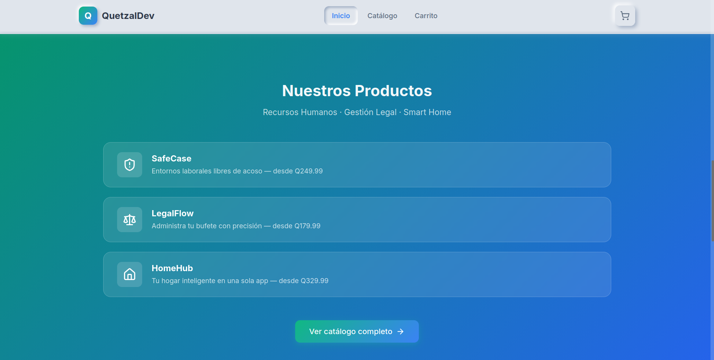
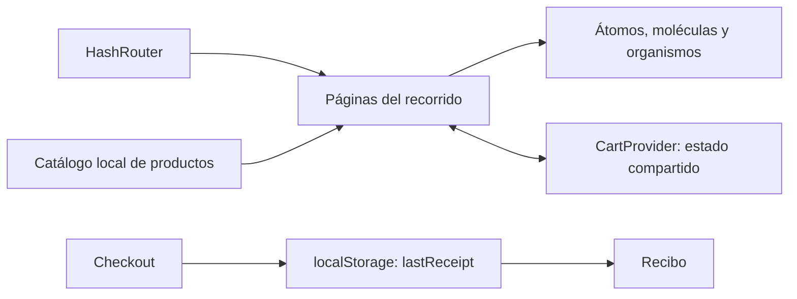

<div align="center">

# 🛒 QuetzalDev — experiencia de compra digital

**Catálogo, carrito y checkout de demostración con React y TypeScript**


[Demo](https://dahfgames.github.io/SOG1_Practica3_1S2026_G28/) · [Funcionalidades](#funcionalidades) · [Inicio rápido](#inicio-rápido) · [Arquitectura](#arquitectura)

</div>

---


## Descripción

Frontend de comercio electrónico desarrollado para la **Práctica 3 de Sistemas Organizacionales y Gerenciales 1**, primer semestre de 2026, grupo 28. Presenta tres productos digitales —SafeCase, LegalFlow y HomeHub— mediante una experiencia que conecta la propuesta comercial, la selección de productos y el comprobante de compra.

El proyecto muestra organización de componentes con Atomic Design, navegación de una SPA, estado compartido del carrito y una interfaz de estilo neumórfico. Las descripciones de los productos forman parte del catálogo: este repositorio implementa la **tienda demostrativa**, no los sistemas de recursos humanos, gestión legal o domótica anunciados por esos productos.



*Captura incluida en la documentación de la entrega. El recorrido completo está en la [guía visual](images/website/websiteFlow.md).*

## Funcionalidades

| Recorrido | Comportamiento |
| --- | --- |
| Inicio | Presenta la marca, los productos y el acceso al catálogo. |
| Catálogo | Muestra las fichas comerciales, precios y características. |
| Carrito | Agrega productos y permite modificar cantidades o retirar artículos. |
| Checkout | Captura los datos solicitados por la compra de demostración. |
| Recibo | Recupera el último comprobante almacenado en el navegador. |
| Bienvenida | Muestra una página asociada al identificador del producto. |

El carrito se mantiene en memoria y el último recibo se guarda en `localStorage` como `lastReceipt`. No hay backend de pedidos ni cobro real; seleccionar un método de pago representa una interacción del prototipo.

## Inicio rápido

El frontend requiere npm y una versión de Node compatible con Vite 7: **Node 20.19+ o 22.12+**. Para una instalación nueva se puede utilizar Node 22.12+ o la rama 24.

```bash
git clone https://github.com/DAHFGAMES/SOG1_Practica3_1S2026_G28.git
cd SOG1_Practica3_1S2026_G28/website
npm ci
npm run dev
```

Abrir la dirección que muestre Vite. El lockfile del proyecto permite instalar las versiones resueltas mediante `npm ci`.

| Comando, desde `website/` | Propósito |
| --- | --- |
| `npm run dev` | Servidor de desarrollo con recarga. |
| `npm run build` | Comprobación TypeScript y compilación a `dist/`. |
| `npm run lint` | Revisión estática mediante ESLint. |
| `npm run preview` | Inspección local de la compilación generada. |

## Arquitectura



`CartProvider` encapsula el estado del carrito y `useCart` permite consumirlo desde los componentes. La navegación con `HashRouter` y `base: './'` en Vite mantienen rutas y recursos relativos para el alojamiento estático.

### Rutas

| URL después de `#` | Pantalla |
| --- | --- |
| `/` | Inicio |
| `/catalogo` | Catálogo |
| `/carrito` | Carrito |
| `/checkout` | Formulario de compra |
| `/recibo` | Último comprobante |
| `/bienvenida/:productId` | Bienvenida por producto |

## Estructura

```text
website/
  src/components/atoms/       Controles y piezas visuales
  src/components/molecules/   Composiciones de controles
  src/components/organisms/   Secciones reutilizables
  src/components/templates/  Estructura compartida de página
  src/components/pages/      Pantallas y recorrido de compra
  src/context/               Contexto, hook y proveedor del carrito
  src/data/                  Catálogo tipado
  public/assets/             Imágenes de los productos
images/website/              Recorrido documentado con capturas
scrum/                       Evidencias de los sprints
```

## Publicación y evidencias

La [demo en GitHub Pages](https://dahfgames.github.io/SOG1_Practica3_1S2026_G28/) utiliza el [workflow de despliegue](.github/workflows/deploy-website.yml), que compila `website/` al publicar cambios en `main`. La integración de un PR no se realiza desde este README: corresponde al propietario y a la configuración de Pages.

- [Recorrido de la interfaz](images/website/websiteFlow.md).
- [Sprint 1](scrum/Sprint1/Sprint.md) y [Sprint 2](scrum/Sprint2/Sprint.md).
- [Diagrama del flujo de trabajo](excalidraw/workflow.excalidraw).

## Comprobación local

Ejecutar `npm run build` y `npm run lint`. Para la revisión manual: añadir un producto, cambiar su cantidad, completar el checkout y comprobar el recibo; al recargar, el recibo puede recuperarse, mientras el carrito vuelve a su estado inicial. En una instalación sin compras previas, `/recibo` muestra el estado vacío.

La compilación, lint y un smoke de renderizado con datos vacíos/poblados se verificaron durante el mantenimiento documental. Ese smoke no sustituye una prueba completa en navegador.

## Equipo

Proyecto colaborativo del **grupo 28**. Las capturas, el historial y los documentos de los sprints conservan la procedencia del trabajo de la entrega.
